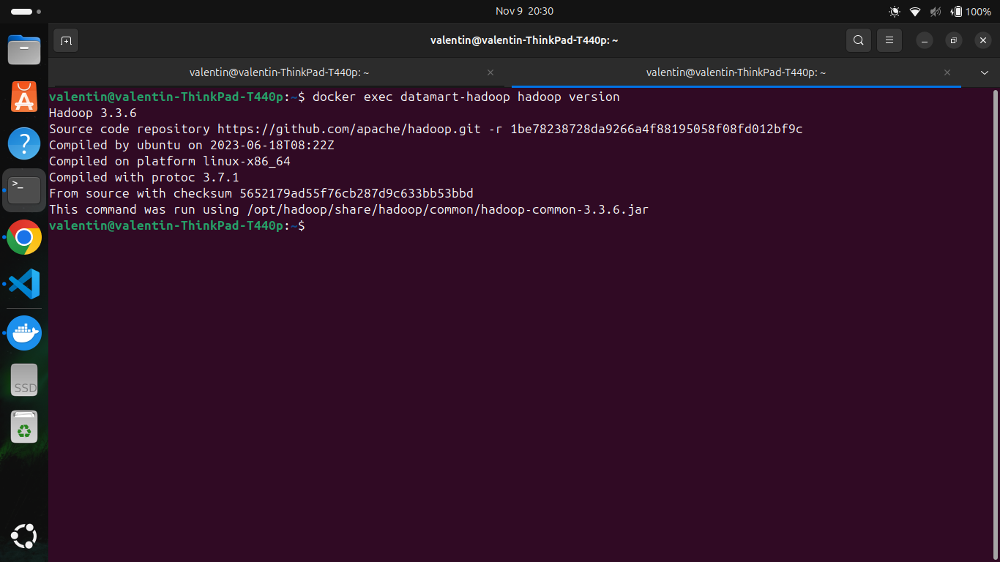
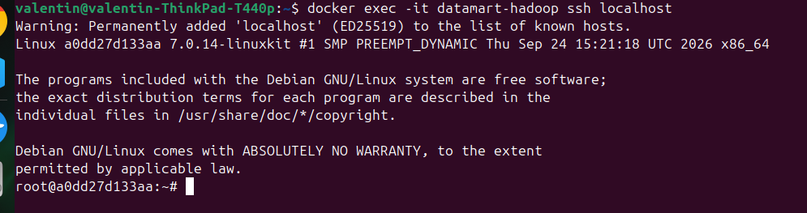
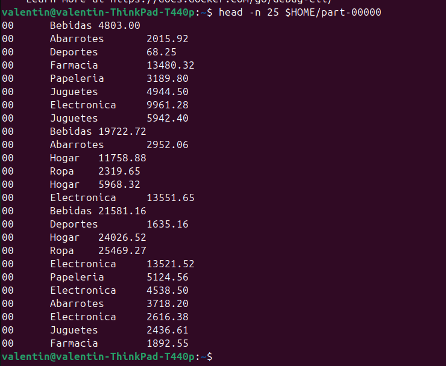
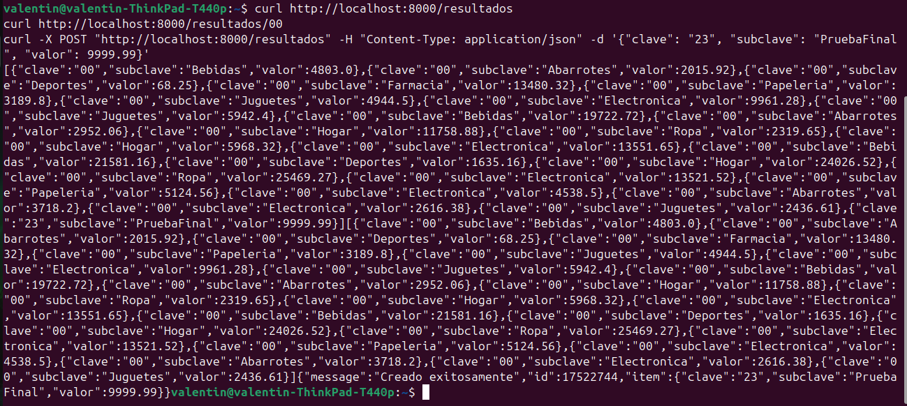

# Examen Segundo Parcial --- Pipeline Big Data Contenerizado

**Matrícula:** `125052199`\
**Pregunta asignada (dígito 9):** Ingreso total por hora del día (0--23)
y categoría.

------------------------------------------------------------------------

## 🚀 Pasos para reproducir el pipeline

### 1. Levantar la infraestructura completa

Desde la carpeta del proyecto, ejecuta:

``` bash
docker compose up --build -d
```

### 2. Cargar los resultados procesados a PostgreSQL

Primero, limpia la tabla `resultados`:

``` bash
docker exec -i datamart-db psql -U hadoop_user -d datamart -c "TRUNCATE TABLE resultados;"
```

Después, carga los resultados generados por Hadoop:

``` bash
grep -E '^[0-9]{2}' "$HOME/part-00000" | head -n 24 | docker exec -i datamart-db psql -U hadoop_user -d datamart -c "COPY resultados(clave, subclave, valor) FROM STDIN WITH (FORMAT csv, DELIMITER E'\t');"
```

> **Nota:** El comando supone que el archivo `part-00000` se encuentra
> en `$HOME`. Ajusta la ruta si tu archivo está en otra ubicación.

### 3. Verificar los endpoints de la API REST

**Consultar todos los resultados:**

``` bash
curl http://localhost:8000/resultados
```

**Filtrar por hora (ejemplo: 00):**

``` bash
curl http://localhost:8000/resultados/00
```

**Probar la escritura mediante POST:**

``` bash
curl -X POST "http://localhost:8000/resultados" \
     -H "Content-Type: application/json" \
     -d '{"clave": "23", "subclave": "PruebaFinal", "valor": 9999.99}'
```

------------------------------------------------------------------------

## 📊 Parte C2: Comparativa de rendimiento

  ------------------------------------------------------------------------
  Método                           Tiempo aproximado Características
  --------------------- ---------------------------- ---------------------
  MapReduce                          30--45 segundos Divide el
  (distribuido)                                      procesamiento en
                                                     fases de Map,
                                                     Shuffle/Sort y
                                                     Reduce.

  Script secuencial                  60--90 segundos Procesamiento
  (Python en el host)                                monohilo, sujeto a
                                                     lecturas continuas de
                                                     E/S en disco.
  ------------------------------------------------------------------------

### Explicación

MapReduce puede ser más eficiente al procesar grandes volúmenes de datos
gracias al paralelismo en la lectura por bloques del dataset y a la
distribución del proceso de ordenamiento (*Shuffle & Sort*).

En cambio, un script monohilo en Python procesa los registros de forma
secuencial. Con cinco millones de registros, el rendimiento puede verse
limitado por las operaciones de entrada/salida (E/S), la memoria
disponible y la recolección de basura.

> **Importante:** Los tiempos indicados son aproximados y dependen del
> hardware, la configuración de Hadoop, el almacenamiento y las
> condiciones de ejecución. Conviene presentar los tiempos medidos
> realmente en tu equipo.

------------------------------------------------------------------------

## 📝 Parte E: Cuestionario de teoría

### 1. Diferencias entre los modos Standalone, Pseudo-distribuido y Totalmente distribuido

-   **Standalone:** Hadoop se ejecuta en un solo proceso JVM en el
    equipo anfitrión, sin daemons distribuidos. No utiliza HDFS; trabaja
    con el sistema de archivos local.
-   **Pseudo-distribuido:** Los daemons de Hadoop (por ejemplo,
    NameNode, DataNode y los servicios de YARN) se ejecutan en una misma
    máquina, simulando un clúster. Puede utilizar HDFS de manera local.
-   **Totalmente distribuido:** Los daemons se ejecutan en varias
    máquinas físicas o virtuales conectadas por red, formando un
    clúster. Utiliza HDFS distribuido entre los nodos.

**En resumen:** HDFS se utiliza en los modos pseudo-distribuido y
totalmente distribuido; el modo standalone utiliza el sistema de
archivos local.

### 2. ¿Por qué el dataset se monta como volumen y no se incluye mediante `COPY`?

1.  **Tamaño y construcción:** Copiar un dataset de 400 MB dentro de la
    imagen aumenta considerablemente su tamaño y puede ralentizar la
    construcción de la imagen (`docker build`).
2.  **Reutilización y persistencia:** Montar el dataset como volumen
    permite cambiarlo o reemplazarlo sin reconstruir la imagen de Docker
    cada vez.
3.  **Separación de responsabilidades:** La imagen contiene la
    aplicación y sus dependencias, mientras que los datos se
    proporcionan por separado.

### 3. Diferencia entre `docker compose down` y `docker compose down -v`

-   **`docker compose down`:** Detiene y elimina los contenedores y las
    redes creadas por Compose. Los datos almacenados en volúmenes
    nombrados se conservan.
-   **`docker compose down -v`:** Además de eliminar los contenedores y
    las redes, elimina los volúmenes asociados declarados por Compose.
    Esto puede borrar permanentemente los datos persistidos, como la
    información de PostgreSQL.

**Precaución:** Antes de ejecutar `down -v`, verifica que no necesites
conservar la información de la base de datos.

### 4. Rendimiento de MapReduce en archivos pequeños o medianos (400 MB)

Para datasets de aproximadamente 400 MB, la sobrecarga de iniciar Hadoop
---JVM, comunicación entre procesos, coordinación de tareas y
operaciones de lectura y escritura--- puede ser mayor que el tiempo
necesario para procesar los datos con un script secuencial.

MapReduce resulta especialmente útil cuando el volumen de datos o la
carga de procesamiento justifican distribuir el trabajo entre varios
nodos. No existe un tamaño único a partir del cual siempre sea más
rápido: depende de la memoria RAM, el número de nodos, el
almacenamiento, la red y la complejidad del procesamiento.

### 5. Diferencias entre instrucciones de Docker

#### `CMD` vs. `ENTRYPOINT`

-   **`ENTRYPOINT`:** Define el ejecutable principal del contenedor.
    Está pensado para establecer qué programa se ejecutará.
-   **`CMD`:** Define el comando o los argumentos predeterminados. Se
    puede sobrescribir al ejecutar el contenedor.

Cuando se utilizan juntos, normalmente `ENTRYPOINT` define el ejecutable
y `CMD` proporciona sus argumentos predeterminados.

#### `COPY` vs. `ADD`

-   **`COPY`:** Copia archivos o directorios desde el contexto de
    construcción hacia la imagen.
-   **`ADD`:** También copia archivos, pero incorpora funciones
    adicionales, como la extracción automática de ciertos archivos
    comprimidos locales y el manejo de fuentes remotas según el formato
    y la versión de Docker.

**Recomendación:** Utiliza `COPY` cuando solo necesites copiar archivos.
Es más explícito y facilita la lectura del Dockerfile.
------------------------------------------------------------------------

## 📷 Evidencias de Funcionamiento

### 1. Version de Hadoop


### 2. Acceso SSH sin contraseña


### 3. Salida del Job MapReduce (part-00000)


### 4. Consultas a la API REST (Endpoints GET y POST)


------------------------------------------------------------------------

## 🎤 Parte F: Preparación para la defensa oral

El profesor puede solicitar cambios en vivo. Ten presentes los
siguientes procedimientos.

### 1. Cambiar el puerto de la API

En el archivo `docker-compose.yml`, modifica la sección `ports` del
servicio de la API.

Por ejemplo:

``` yaml
ports:
  - "8080:8000"
```

Esto publica el puerto `8000` del contenedor en el puerto `8080` del
equipo anfitrión. Después, aplica el cambio:

``` bash
docker compose up -d api
```

La API quedaría disponible en:

``` text
http://localhost:8080
```

### 2. Borrar la base de datos y reiniciar desde cero

**Advertencia:** Este procedimiento elimina los volúmenes administrados
por Compose y puede borrar los datos persistidos de PostgreSQL.

``` bash
docker compose down -v
docker compose up --build -d
```

Cuando los servicios estén listos, vuelve a cargar los resultados con
los comandos de la sección **2. Cargar los resultados procesados a
PostgreSQL**.

------------------------------------------------------------------------

## ✅ Lista de verificación antes de entregar

-   [ ] La infraestructura inicia correctamente con
    `docker compose up --build -d`.
-   [ ] El procesamiento MapReduce genera el archivo `part-00000`.
-   [ ] La tabla `resultados` recibe los datos procesados.
-   [ ] El endpoint `GET /resultados` responde correctamente.
-   [ ] El filtro `GET /resultados/00` responde correctamente.
-   [ ] El endpoint `POST /resultados` permite insertar un registro de
    prueba.
-   [ ] Se tienen registrados los tiempos reales de MapReduce y Python
    para la comparativa.
-   [ ] Se puede explicar la diferencia entre los modos de ejecución de
    Hadoop.
-   [ ] Se puede explicar el uso de volúmenes y las instrucciones
    principales de Docker.

------------------------------------------------------------------------

**Fin del documento.**
